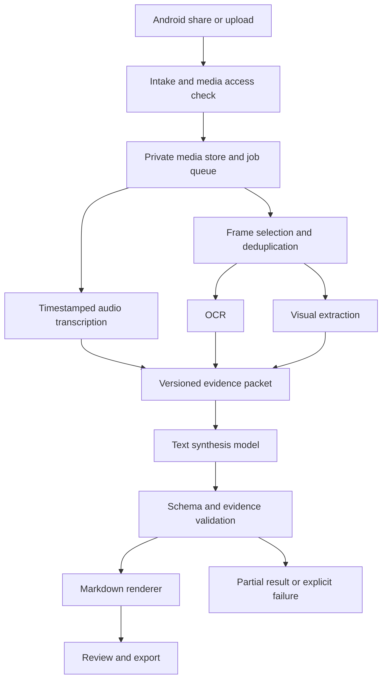

# Architecture and output contract

## Data flow

The model receives text only. Screenshots remain available to the human reviewer and optional export bundle. The vision model performs extraction, not the project's fine-tuning task.

## Intake and extraction

Test the Android share payload on the user's actual Instagram app. Record whether it provides text, a URL, or media. Test media retrieval separately. Do not infer retrieval success from receipt of a URL. Upload remains the reliable development path.

Proposed pilot sampling starts at one frame every two seconds, supplemented by significant screen changes, with a cap of 60 selected frames per clip. These are tunable starting settings. Record whether the cap or sampling missed short events. Preserve readable original-resolution crops for technical regions and record crop coordinates and parent frame IDs.

Run OCR across selected frames, deduplicate repeated text conservatively, and keep timestamps. Apply the vision comparison to three preselected informative frames per clip. A production policy may use more frames after measuring benefit and cost.

Record ASR segments and extraction failures. Empty audio is different from transcription failure. Do not silently replace failed channels with fabricated text. All evidence IDs remain stable within an immutable packet version.

## Evidence contract

Each evidence record contains an ID, kind, start/end time in seconds, and extracted text. Kinds are transcript, OCR, or visual description. A review flag distinguishes a normal extraction from an uncertain one; it is not a calibrated confidence score.

The packet records clip duration, available/empty/failed status for each channel, pipeline version, and truncation status. Source links, acquisition rights, raw assets, credentials, and annotator identity belong in separate metadata and are not automatically passed to the model.

See [evidence schema](schemas/evidence.schema.json). Additional semantic checks must require unique IDs, valid time ordering, timestamps within clip duration, and consistent channel status. If truncation occurs, retain an audit record and flag the result partial; do not quietly trim critical evidence or target completions.

## Output contract

See [target schema](schemas/target.schema.json). Output includes:

- Title and completion status.
- Atomic claims with evidence IDs and attribution.
- Ordered steps with evidence IDs and optional exact command.
- Conflicts, unknowns, and omissions.

Uncertainty must refer to an identifiable gap. Do not infer deployment location, performance, success, or causal relationships absent from evidence. Unsupported optional information is omitted; important missing information is stated.

The renderer generates an overview from the recorded fields, claims, steps, conflicts, limitations, evidence index, and optional raw transcript/OCR appendices. Avoid a second unvalidated prose summary. Append raw evidence deterministically after redaction; do not ask the model to copy the complete transcript.

## Training and serving paths

Training: source media → fixed extraction → teacher target → validation → human review → versioned dataset → adapter training.

Serving: new media → identical versioned extraction policy → synthesis model plus adapter → validation → safe Markdown export.

Keep teacher-only annotations and review decisions out of student inputs. If a teacher or reviewer sees additional source evidence, incorporate it into a revised packet before using it in a target, or omit that unsupported content.

## Implementation boundaries

Proposed components: a small Android share client, Python processing service, asynchronous job queue, private asset storage, and JSONL dataset tools. Select concrete vendors and frameworks during implementation. The pilot can run locally as an offline pipeline; no public service is required.

A job moves through queued, extracting, synthesizing, validating, complete, partial, or failed. Each transition records a reason and version. Queue retries must be idempotent to avoid duplicate charges and inconsistent exports.

Freeze extraction per experiment. An extraction upgrade creates a new dataset version and requires regression evaluation.
